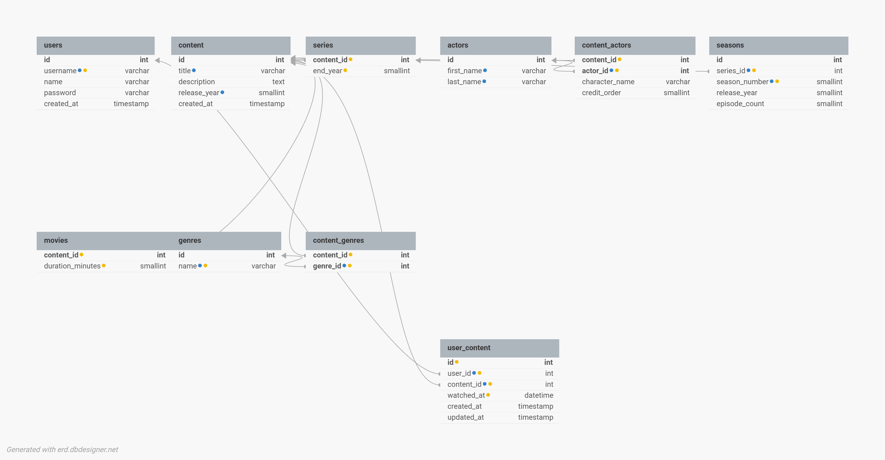

# Trailerfix

**Trailerfix** es una aplicación de recomendaciones de películas y series que permite a los usuarios descubrir contenido, guardar recomendaciones para ver luego y llevar un registro de lo que ya han visto.

---

## Desarrolladores

- Ezequiel Federico Cabrera
- Pablo Alejandro Kazalukian

## Funcionalidades

| Funcionalidad                                  | Estado          | Detalle                                                                                                                                                                                            |
| ---------------------------------------------- | --------------- | -------------------------------------------------------------------------------------------------------------------------------------------------------------------------------------------------- | ----------- | ------ |
| **Búsqueda de contenido**                      | ✅ Implementada | Búsqueda por nombre (`title`), tipo (`MOVIE`/`SERIES`), año de estreno (`year`) y género (`genre` o `genreId`).                                                                                    |
| **Búsqueda por actor**                         | ✅ Implementada | `GET /api/actors/:id/contents` devuelve películas y series donde trabajó el actor.                                                                                                                 |
| **Estado de visualización en respuestas**      | ✅ Implementada | En peticiones autenticadas, cada contenido incluye `userStatus: "WATCHED"                                                                                                                          | "WATCHLIST" | null`. |
| **Registro y login de usuarios**               | ✅ Implementada | Auth con JWT (`POST /api/auth/register`, `POST /api/auth/login`, `GET /api/auth/me`).                                                                                                              |
| **Lista de pendientes (Watchlist)**            | ✅ Implementada | `POST /api/me/content` con `status: "WATCHLIST"` para guardar contenido para ver luego.                                                                                                            |
| **Marcar como visto**                          | ✅ Implementada | `PATCH /api/me/content/:contentId` con `status: "WATCHED"`; setea `watchedAt` automáticamente.                                                                                                     |
| **Excluir vistos en búsquedas "qué ver"**      | 🔄 Planeada     | Actualmente `/api/contents` es público y no filtra por usuario. El comportamiento deseado es que, al buscar "qué ver" autenticado, no se devuelvan contenidos con `status: "WATCHED"` del usuario. |
| **Catálogo con géneros, actores y temporadas** | ✅ Implementada | Relaciones completas: géneros (N:M), actores con personaje/orden (N:M), temporadas de series (1:N).                                                                                                |
| **Gestión de catálogo (admin)**                | ✅ Implementada | CRUD de contenidos, géneros, actores y temporadas (requiere token).                                                                                                                                |

> **Nota:** La fila marcada como 🔄 Planeada refleja el comportamiento de producto objetivo; la implementación actual está documentada en la [API README](trailerfix-api/README.md).

---

## Arquitectura

```
trailerfix/
├── trailerfix-api/   # Backend (Node.js, Express, Sequelize, MySQL, JWT)
├── frontend/         # Frontend (en desarrollo — no incluido aún en este repositorio)
├── data/             # Scripts SQL de referencia (p.ej. `Trailerflix.sql`)
└── README.md         # Este archivo
```

- **API** (`trailerfix-api/`): REST API stateless con autenticación JWT. Sirve el catálogo, auth y listas personales.
- **Frontend**: Planeado/En desarrollo. Consumirá la API. Aún no existe en este repositorio.
- **Base de datos**: MySQL 8+. Esquema versionado con migraciones Sequelize. Detalle en [`trailerfix-api/src/database/README.md`](trailerfix-api/src/database/README.md).

---

## Stack principal (API)

- **Runtime**: Node.js ≥ 22.12 (ES Modules)
- **Framework**: Express 5
- **ORM**: Sequelize 6
- **Base de datos**: MySQL 8 (o MariaDB compatible)
- **Autenticación**: JWT (`jsonwebtoken`) + `bcryptjs` para hash de contraseñas
- **Validación**: Middlewares propios (sin librería externa)

---

## Cómo empezar

1. **API (backend)**  
   Ver instrucciones completas en **[`trailerfix-api/README.md`](trailerfix-api/README.md)**:
   - Requisitos, instalación, variables de entorno (`.env`)
   - Comandos: `npm run dev`, `npm run db:migrate`, `npm run db:seed`, `npm run db:reset`
   - Endpoints, autenticación, ejemplos de peticiones reales

2. **Base de datos (detalle técnico)**  
   Esquema, tablas, índices, relaciones, constraints, configuración Sequelize y discrepancias con `data/Trailerflix.sql` en **[`trailerfix-api/src/database/README.md`](trailerfix-api/src/database/README.md)**.

3. **Frontend**  
   Pendiente. Cuando esté disponible, se añadirá su propio README y se enlazará desde aquí.

---

## Credenciales de demo (seeders)

| Usuario | Contraseña  |
| ------- | ----------- |
| `admin` | `Admin123!` |

Estos datos los crea el seeder `20261113000001-demo-user.js` al ejecutar `npm run db:seed` dentro de `trailerfix-api/`.

---

## Estado del proyecto

- ✅ **Fase 1** — Modelo de datos: 10 tablas + modelos Sequelize con asociaciones completas.
- ✅ **Fase 2** — API: CRUD de 5 recursos (contenidos, géneros, actores, temporadas, lista personal), filtros, validaciones, manejo de errores.
- ✅ **Fase 3** — Seeders: 6 contenidos (3 películas + 3 series), 10 géneros, 10 actores, 10 temporadas, 4 entradas de usuario demo.
- ✅ **Fase 4** — Búsqueda por actor + estado de visualización en respuestas.
- ✅ **Documentación** — README raíz, API y BD actualizados y consistentes.
- ⏳ **Frontend** — Por iniciar.

---

## Diseño de la base de datos (SQL)

### Diagrama entidad-relación



### Archivo SQL

- **`data/Trailerflix.sql`**: muestra completa del **diseño de la base de datos** en SQL puro (MySQL 8.0+ / InnoDB). Define el esquema **`trailerfix_db`** con las 10 tablas, relaciones, constraints, índices y datos de prueba, **alineado 1:1 con las migraciones/seeders de `trailerfix-api`**:
  - **Esquema relacional completo**: 10 tablas (`users`, `content`, `movies`, `series`, `genres`, `content_genres`, `actors`, `content_actors`, `seasons`, `user_content`) con PK/FK, `ON DELETE/UPDATE CASCADE`, `CHECK` constraints, `ENUM`s e índices.
  - **Convenciones**: tablas nuevas en `snake_case` + `underscored: true`; `users` (legacy) con `createdAt`/`updatedAt` camelCase.
  - **Datos de prueba (seed)**: usuario `admin` / `Admin123!` (hash bcrypt real, 10 rounds), 6 contenidos (3 películas + 3 series), 10 géneros, 10 actores con personaje/orden, 10 temporadas, 4 estados de usuario (2 `WATCHED`, 2 `WATCHLIST`).
  - **Sin lógica de aplicación**: no incluye `UPDATE`, `INSERT ... ON DUPLICATE KEY` ni consultas de ejemplo (eso vive en los controllers/endpoints de la API).
  - **Propósito**: referencia portable del diseño, onboarding, recrear esquema sin Sequelize, CI alternativo o documentación.

---

## Enlaces rápidos

- [API README](trailerfix-api/README.md) — Endpoints, auth, peticiones, errores, estructura de código.
- [Database README](trailerfix-api/src/database/README.md) — Esquema detallado, campos, índices, FKs, constraints, migraciones, seeders, configuración.
- [Diseño de BD (SQL)](data/Trailerflix.sql) — Muestra completa del diseño (DB `trailerfix_db`, seed `admin`/`Admin123!`, alineado 1:1).
